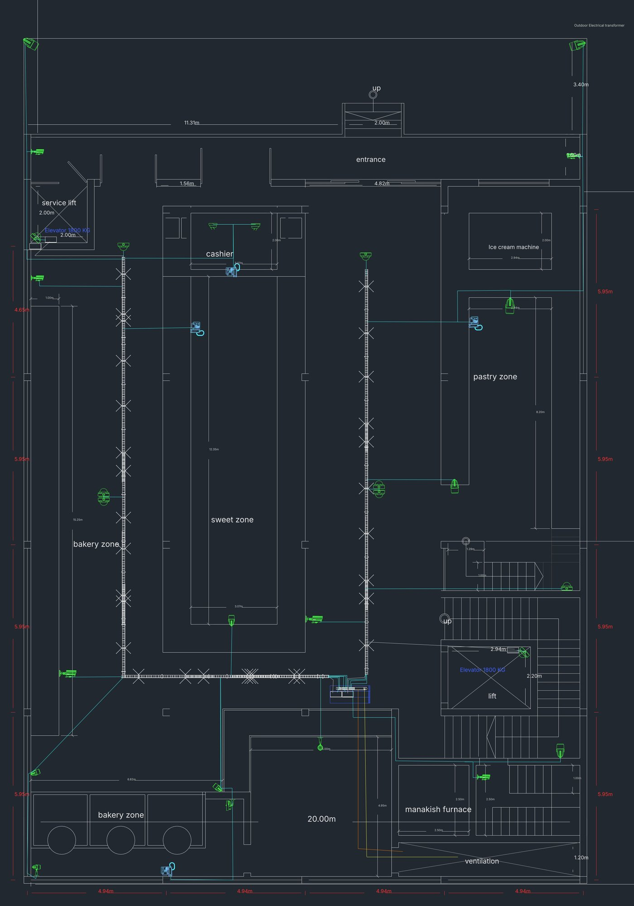
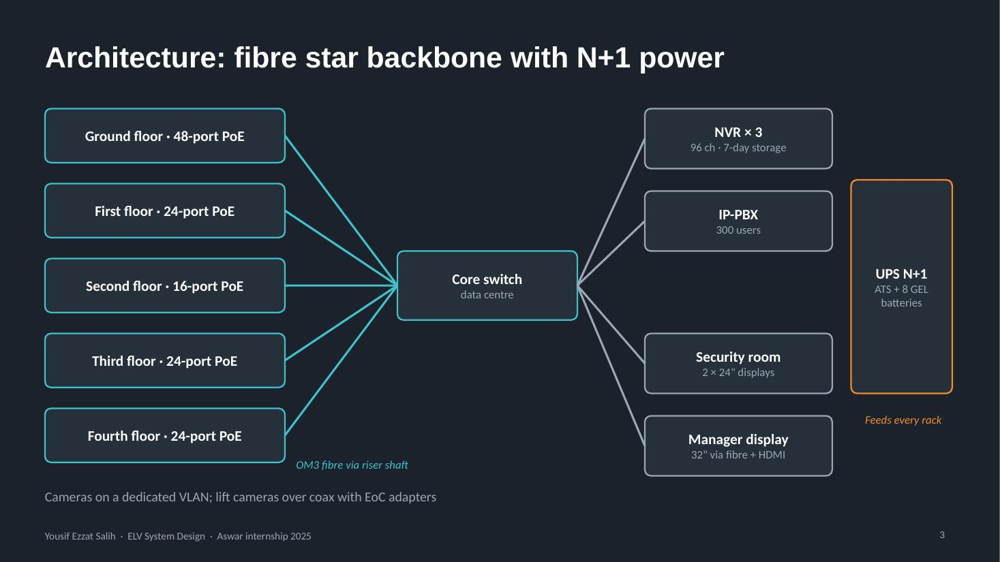
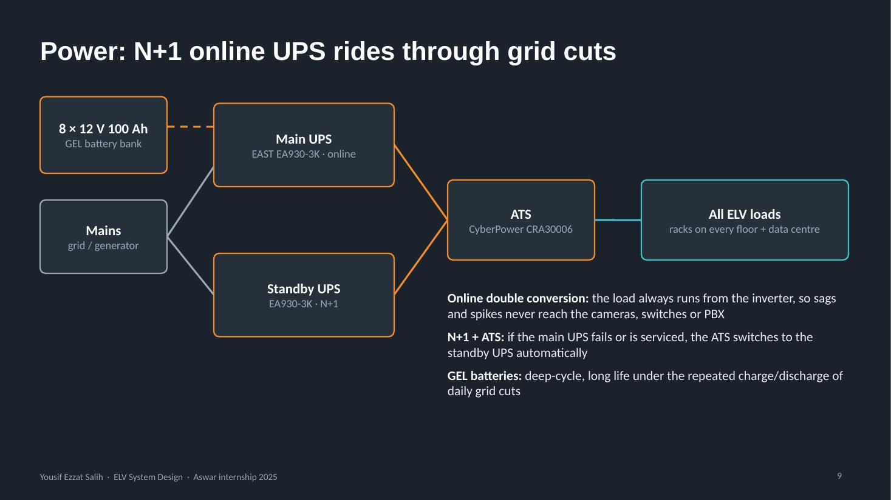
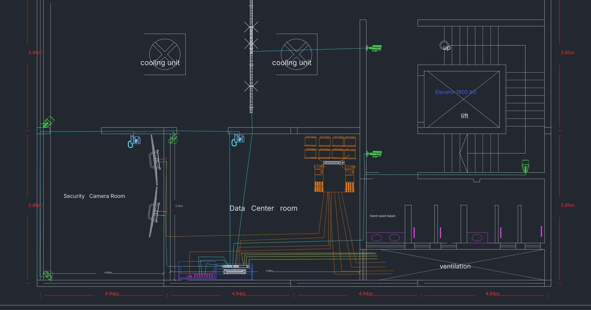
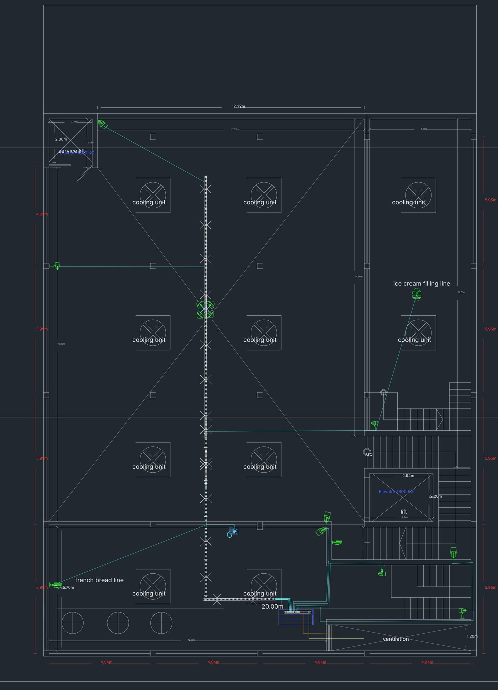
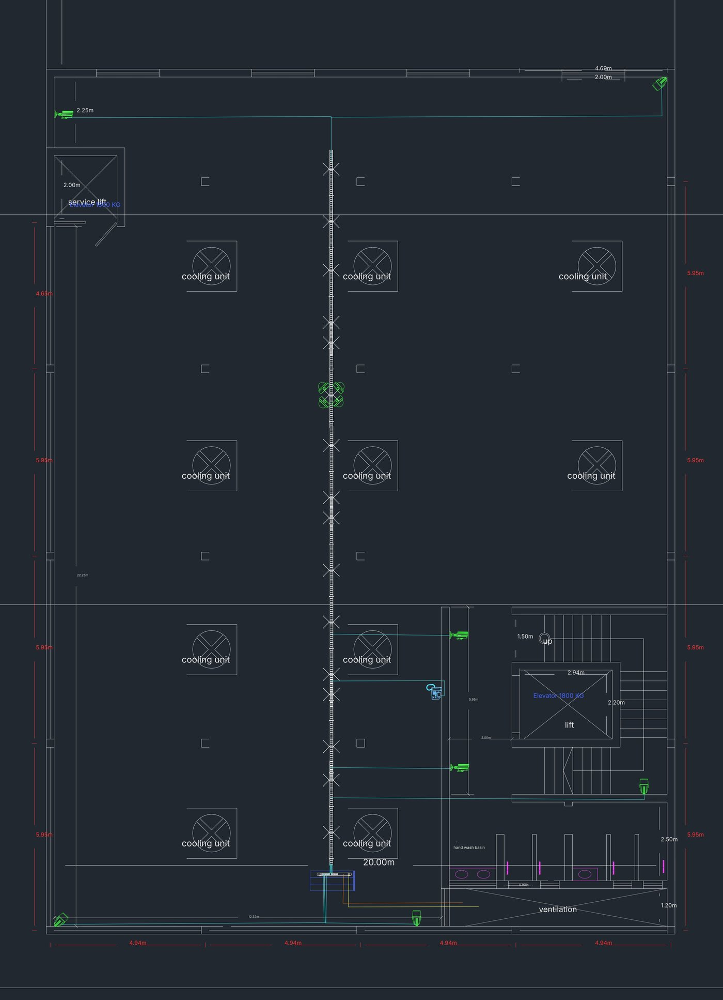
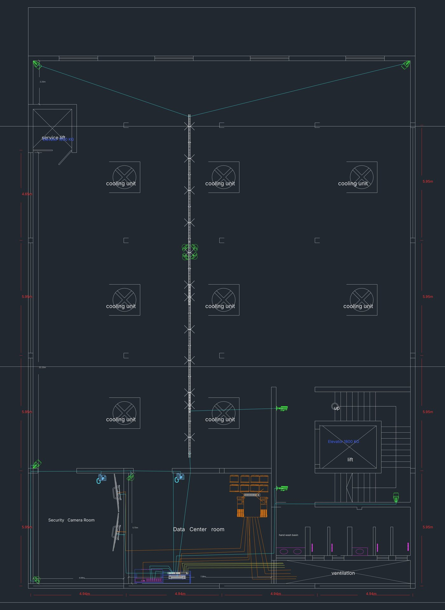
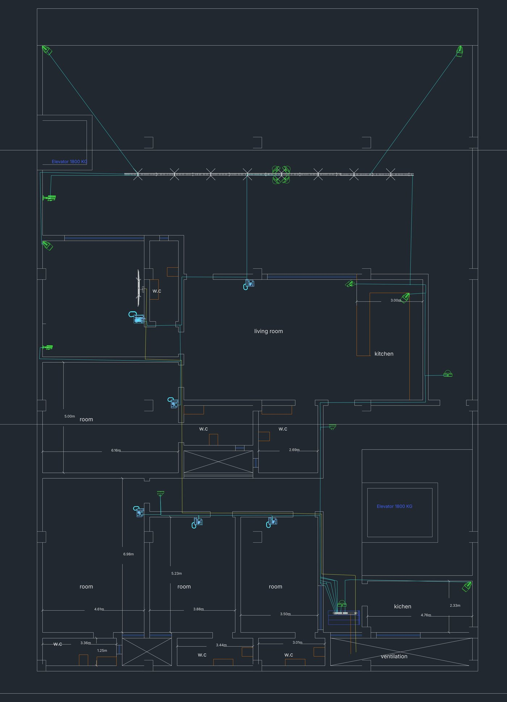

# ELV System Design — 5-Floor Commercial Building

Complete **Extra-Low-Voltage (ELV)** design for a five-floor bakery & confectionery building: IP CCTV, IP telephony, structured cabling, a data-centre room and an **N+1 redundant UPS** power system. Drawn in **AutoCAD**, with every quantity backed by a calculation and a full bill of materials.

> **Aswar internship project, July–August 2025** (final grade 90/100).
> **Role: project lead** — AutoCAD drawing and device blocks, power system and data-centre design, design review and final integration of all systems.

---

## At a glance

| | |
|---|---|
| **IP cameras** | 83 (4 × 8 MP, 79 × 2 MP) |
| **Camera traffic** | 348 Mbps |
| **Video storage** | ≈ 26 TB for 7-day retention → 3 NVRs, 30 TB |
| **IP phones** | 14 + IP-PBX (300 users) |
| **Design load** | 1,146 W → 1,320 W with 15 % margin |
| **Backup** | 2 × 3 kVA online UPS (N+1) + ATS, ≈ 5 h battery runtime |

## The building

| Floor | Use | Cameras | Phones | Switch |
|---|---|---|---|---|
| Ground | Retail: bakery, sweets & pastry zones, cashier | 28 | 4 | 48-port PoE |
| First | Production | 16 | 1 | 24-port PoE |
| Second | Production | 11 | 1 | 16-port PoE |
| Third | Production + **data centre** + **security room** | 12 | 2 | 24-port PoE |
| Fourth | Staff residential | 16 | 6 | 24-port PoE |
| **Total** | | **83** | **14** | |

## Architecture

- **Star topology:** every floor switch connects to the core switch in the data centre over **OM3 multimode fibre** through the riser shaft.
- **Shielded Cat6** from each camera and phone to its floor switch, because the production floors are full of ovens, cooling units and motors that cause interference.
- **Lifts:** cameras use flexible **RG6 coax** with **Ethernet-over-Coax PoE adapters** (Dualcomm DECA-200), because twisted pair does not survive the constant movement of a lift cable.
- **Security:** cameras sit on a dedicated **VLAN**.

## CCTV

- **Car park:** 2 × 8 MP outdoor bullets (IP67, 30 m IR) for number plates and faces.
- **Cashier:** 2 × 8 MP domes directly above the till.
- **All zones:** 79 × 2 MP bullets and domes; none in washrooms or private rooms.
- **Bandwidth:** 8 MP ≈ 8 Mbps, 2 MP ≈ 4 Mbps (H.265) → **348 Mbps** in total.
- **Storage:** 348 Mbps × 86,400 s ÷ 8 = 3.76 TB/day → **≈ 26 TB for 7 days**, so 3 × 32-channel 4K NVRs (96 channels, 13 spare), each with a 10 TB surveillance disk.
- **Viewing:** security room with two 24" displays; view-only 32" display in the manager's office over fibre + HDMI extender.

## Power system

- **Online double-conversion UPS (EAST EA930-3K):** the load always runs from the inverter, so grid sags and spikes never reach the equipment.
- **N+1 with automatic transfer:** a second identical UPS in standby; the **CyberPower CRA30006 ATS** switches to it automatically if the main UPS fails or is being serviced.
- **Battery bank:** 8 × 12 V 100 Ah **GEL** batteries (9.6 kWh nominal), deep-cycle and tolerant of the frequent grid cuts in Iraq.

| Area | Load (W) |
|---|---|
| Ground floor | 264 |
| First floor | 149 |
| Second floor | 109 |
| Third floor | 118 |
| Fourth floor | 176 |
| Data centre | 330 |
| **Total** | **1,146** |
| **+15 % expansion margin** | **≈ 1,320** |

- **UPS loading:** 1,320 W on a 3 kVA unit is ≈ 55 % at PF 0.8, leaving headroom.
- **Runtime:** 9,600 Wh × 80 % depth of discharge × 90 % inverter efficiency ÷ 1,320 W ≈ **5.2 hours**.

## Data centre & security room (third floor)

The data centre holds the main and standby UPS, battery bank and ATS, the core switch, the 3 NVRs and the IP-PBX, all fed from the central UPS. It is designed for **22 °C ± 2 °C** and **40–60 % relative humidity** to protect the electronics and extend battery life.

## Floor plans

| First floor | Second floor | Third floor | Fourth floor |
|---|---|---|---|
|  |  |  |  |

Symbol legend: [`media/legend.jpg`](media/legend.jpg)

## Files

| Path | Content |
|---|---|
| [`drawings/elv_5_floor_building.dwg`](drawings/elv_5_floor_building.dwg) | Full AutoCAD drawing, all floors and systems |
| [`drawings/drawing_sheets.pdf`](drawings/drawing_sheets.pdf) | 7 drawing sheets: five floors, data-centre detail, legend |
| [`docs/presentation.pdf`](docs/presentation.pdf) · [`.pptx`](docs/presentation.pptx) | Project presentation (13 slides) |
| [`docs/bill_of_materials.xlsx`](docs/bill_of_materials.xlsx) | Bill of materials (27 items), cameras-by-floor and power-budget calculations |

## Skills demonstrated

AutoCAD · ELV system design · CCTV bandwidth & storage sizing · structured cabling (Cat6, fibre, coax) · PoE switching & VLANs · IP telephony · UPS sizing, N+1 redundancy & battery runtime · data-centre planning · bill of materials
